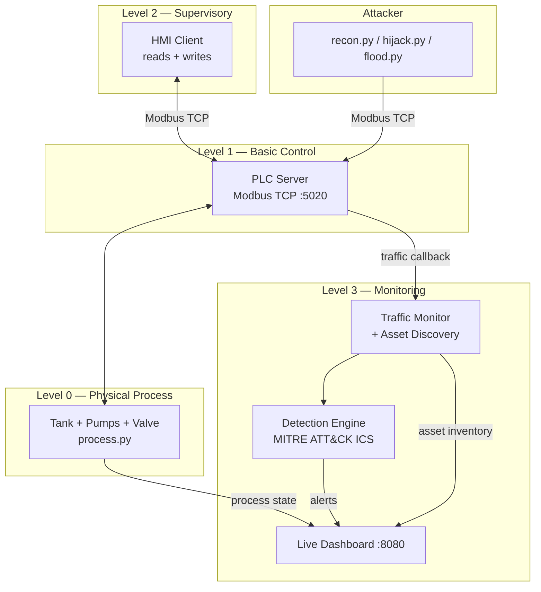

# Forge

ICS/SCADA security monitoring lab with a simulated water treatment plant.

Forge runs a virtual water treatment facility — tank, intake pump, chemical
dosing, outlet valve — on a real Modbus TCP server you can point any Modbus
tool or attack script at. An HMI keeps the plant running while a passive
monitor watches every frame, detects threats, and maps them to MITRE ATT&CK
for ICS. A live dashboard shows plant state, alerts, and an OT asset
inventory in real time.

The Modbus TCP layer is written from scratch, no libraries. Every byte on the
wire is parsed and inspected.

## What it covers

| ICS security domain | Where in Forge |
|---|---|
| Industrial protocols | Hand-built Modbus TCP (MBAP + PDU) in `forge/protocol/modbus.py` |
| ICS architecture | Purdue model mapping in `docs/purdue-model.md`, PLC → HMI → monitor layering |
| Process simulation | Water treatment physics in `forge/simulator/process.py` |
| Network monitoring | Passive traffic capture and asset discovery in `forge/monitor/` |
| Threat detection | Six rules in `forge/detect/engine.py`, each mapped to MITRE ATT&CK for ICS |
| Baseline anomaly detection | Statistical process baseline in `forge/monitor/baseline.py` |
| Attack simulation | Recon, hijack, and flood scripts in `scripts/` |
| Incident response | Alerts with severity, source IP, technique, and tactic for triage |

## How it fits together



## Quick start

```bash
pip install -e ".[dev]"

# Start the full lab: PLC + HMI + monitor + dashboard
python -m forge run
# Dashboard at http://127.0.0.1:8080
# PLC at 127.0.0.1:5020 (Modbus TCP)
```

In another terminal, run the attack scripts:

```bash
# Scan for PLCs
python scripts/recon.py

# Drain the tank
python scripts/hijack.py drain

# Chlorine overdose
python scripts/hijack.py overdose

# Trigger emergency stop
python scripts/hijack.py estop

# Mask alarms by moving thresholds
python scripts/hijack.py mask

# Flood the PLC
python scripts/flood.py --duration 10
```

Watch the dashboard — alerts appear in real time with MITRE ATT&CK tags.

## Detection rules

| Rule | Fires when | ATT&CK for ICS |
|---|---|---|
| ICS-001: Unauthorized write | Write from an IP that is not the HMI | T0855 — Unauthorized Command Message |
| ICS-002: Reconnaissance scan | 5+ unit IDs probed within 10 seconds | T0846 — Remote System Discovery |
| ICS-003: Dangerous setpoint | Alarm threshold pushed outside safe range | T0836 — Modify Parameter |
| ICS-004: E-stop manipulation | Emergency stop coil toggled by non-HMI | T0816 — Device Restart/Shutdown |
| ICS-005: Modbus flooding | Request rate exceeds 5 req/s from single IP | T0814 — Denial of Service |
| ICS-006: Coil brute force | 8+ coil writes in 5 seconds | T0806 — Brute Force I/O |
| ICS-007: Process anomaly | Process value deviates 3σ from baseline | T0831 — Manipulation of Control |

## Register map

**Coils** (read/write):

| Address | Name | Description |
|---|---|---|
| 0 | intake_pump | Intake pump on/off |
| 1 | dosing_pump | Chemical dosing pump on/off |
| 2 | outlet_valve | Outlet valve open/close |
| 3 | emergency_stop | Emergency stop (kills all actuators) |

**Holding registers** (read/write, uint16):

| Address | Name | Range |
|---|---|---|
| 0 | intake_rate | 0-100 % |
| 1 | dose_rate | 0-100 % |
| 2 | tank_high_thresh | 0-100 % (default 90) |
| 3 | tank_low_thresh | 0-100 % (default 10) |
| 4 | chlorine_target | 0-100 (maps to 0-10 mg/L) |

**Input registers** (read-only, value × 100):

| Address | Name | Unit |
|---|---|---|
| 0 | tank_level | 0.00-100.00 % |
| 1 | chlorine_level | 0.00-10.00 mg/L |
| 2 | inlet_pressure | 0.00-100.00 PSI |
| 3 | outlet_pressure | 0.00-100.00 PSI |
| 4 | flow_rate | 0.00-100.00 GPM |

**Discrete inputs** (read-only):

| Address | Name |
|---|---|
| 0 | tank_high_alarm |
| 1 | tank_low_alarm |
| 2 | chlorine_high_alarm |
| 3 | chlorine_low_alarm |
| 4 | system_fault |

## Project layout

```
forge/
  protocol/modbus.py    Modbus TCP frame parser and builder (from scratch)
  simulator/
    process.py          Water treatment plant physics
    plc.py              PLC server (Modbus TCP, asyncio)
    hmi.py              HMI client that keeps the plant in safe range
  monitor/
    capture.py          Traffic monitor and OT asset discovery
    baseline.py         Statistical process value baseline
  detect/
    engine.py           Detection rules with MITRE ATT&CK for ICS
  dashboard/
    server.py           Live web dashboard (HTTP + WebSocket)
    static/             Dashboard HTML, CSS, JS
  events.py             Alert model and pub/sub bus
scripts/
  recon.py              Modbus reconnaissance scanner
  hijack.py             Unauthorized write attacks (drain, overdose, estop, mask)
  flood.py              Modbus DoS
docs/
  purdue-model.md       Purdue Enterprise Reference Architecture mapping
tests/                  Unit tests for protocol, process, and detection
```

## Tests

```bash
pytest
```

## License

MIT. Copyright (c) 2026 Primel Jayawardana.
